# Pruebas del módulo de gestión de pacientes

Evidencia GA7-220501096-AA3-EV02 · MediCitas · Carlas Elenys Montalvo Mendoza, Freyder López

## Historias de usuario

### HU-01 · Listar pacientes

**Como** administrador de MediCitas, **quiero** ver el listado de los pacientes registrados, **para** conocer quiénes están en el sistema y el estado de su cuenta.

- Prioridad: Alta · Ruta: `GET /pacientes`

Criterios de aceptación:

1. Se muestran nombre completo, tipo y número de documento, correo, edad y estado de cada paciente.
2. El listado se ordena por apellidos y nombres.
3. Se indica el total de pacientes listados.
4. Cada fila tiene un botón «Ver» que abre el detalle.

**Resultado:** Cumple. El listado muestra los 11 pacientes de la base de datos real de MediCitas, ordenados por apellido, con la edad calculada a partir de la fecha de nacimiento y la etiqueta de estado (Activo / Inactivo).

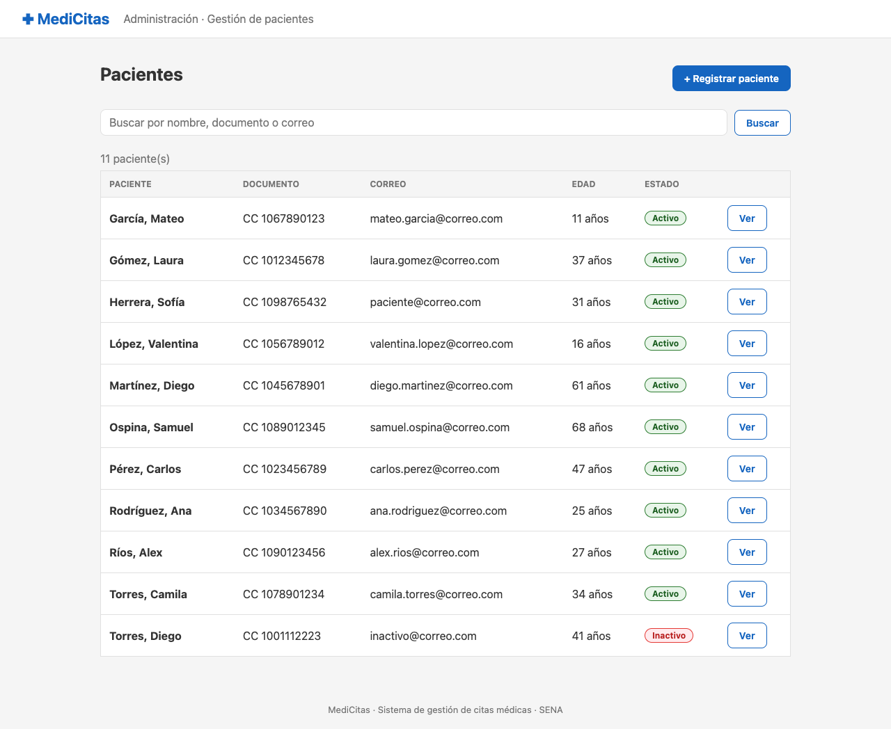

### HU-02 · Buscar pacientes

**Como** administrador, **quiero** buscar un paciente por nombre, apellido, documento o correo, **para** encontrarlo rápido sin recorrer todo el listado.

- Prioridad: Alta · Ruta: `GET /pacientes?buscar=texto`

Criterios de aceptación:

1. La búsqueda encuentra coincidencias parciales en nombres, apellidos, documento y correo.
2. No distingue mayúsculas de minúsculas.
3. Si no hay coincidencias se muestra un mensaje claro.
4. El enlace «Ver todos» limpia la búsqueda.

**Resultado:** Cumple. Al buscar «gómez» aparece Laura Gómez; al buscar «zzz» se muestra «No hay pacientes que coincidan con la búsqueda».

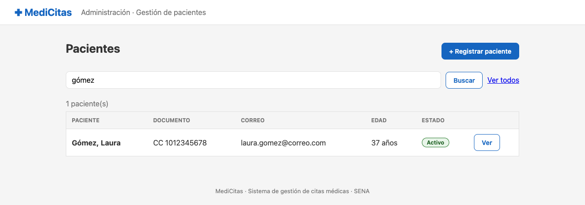

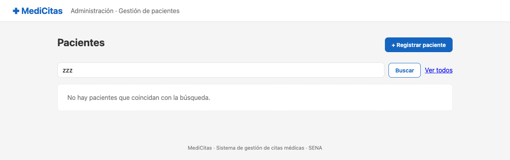

### HU-03 · Registrar paciente

**Como** administrador, **quiero** registrar un paciente nuevo con sus datos personales y de contacto, **para** que pueda acceder al sistema y agendar citas.

- Prioridad: Alta · Ruta: `GET /pacientes/nuevo · POST /pacientes`

Criterios de aceptación:

1. Son obligatorios el tipo y número de documento, nombres, apellidos, correo, fecha de nacimiento y género.
2. Cada dato inválido muestra su mensaje debajo del campo y el formulario conserva lo escrito.
3. No se permite un documento (tipo + número) ni un correo ya registrados.
4. Se crea el usuario con rol PATIENT y el registro de paciente en una sola transacción.
5. Se genera una contraseña temporal que se muestra una sola vez y se guarda cifrada con BCrypt.

**Resultado:** Cumple. Con datos válidos se crea la paciente Lucía Andrea Pérez Gómez y se muestra su contraseña temporal. Las pruebas de cada validación se documentan en la sección 6.

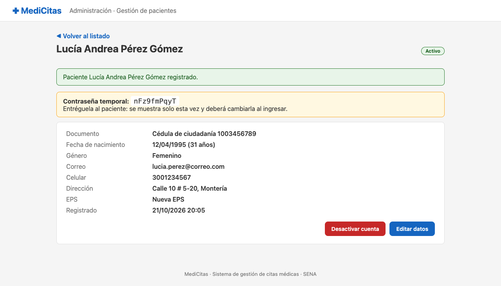

### HU-04 · Consultar paciente

**Como** administrador, **quiero** consultar el detalle de un paciente, **para** revisar sus datos completos.

- Prioridad: Media · Ruta: `GET /pacientes/{id}`

Criterios de aceptación:

1. Se muestran documento, fecha de nacimiento con la edad, género, correo, celular, dirección, EPS y fecha de registro.
2. Los datos opcionales vacíos se muestran con un guion.
3. La contraseña temporal no vuelve a aparecer al consultar de nuevo.

**Resultado:** Cumple. Al volver a abrir a la paciente desde el listado se ven todos sus datos y ya no aparece la contraseña temporal.

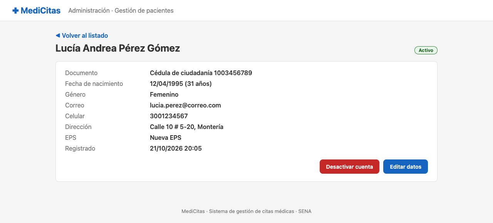

### HU-05 · Editar paciente

**Como** administrador, **quiero** actualizar los datos de un paciente, **para** mantener su información de contacto al día.

- Prioridad: Media · Ruta: `GET /pacientes/{id}/editar · POST /pacientes/{id}`

Criterios de aceptación:

1. El formulario se abre con los datos actuales.
2. Se aplican las mismas validaciones que en el registro.
3. El paciente puede conservar su propio documento y correo sin que se tomen como duplicados.
4. Al guardar se confirma con un mensaje.

**Resultado:** Cumple. Un celular incompleto («31098») se rechaza; con «3109876543» y la EPS «Sura EPS» los cambios se guardan y se confirma «Datos de … actualizados».

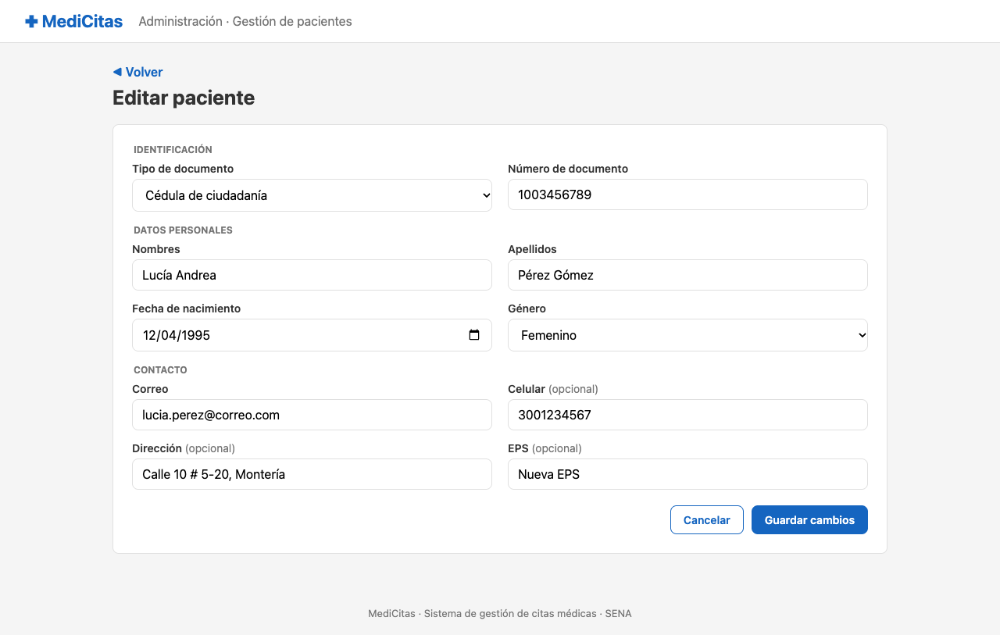

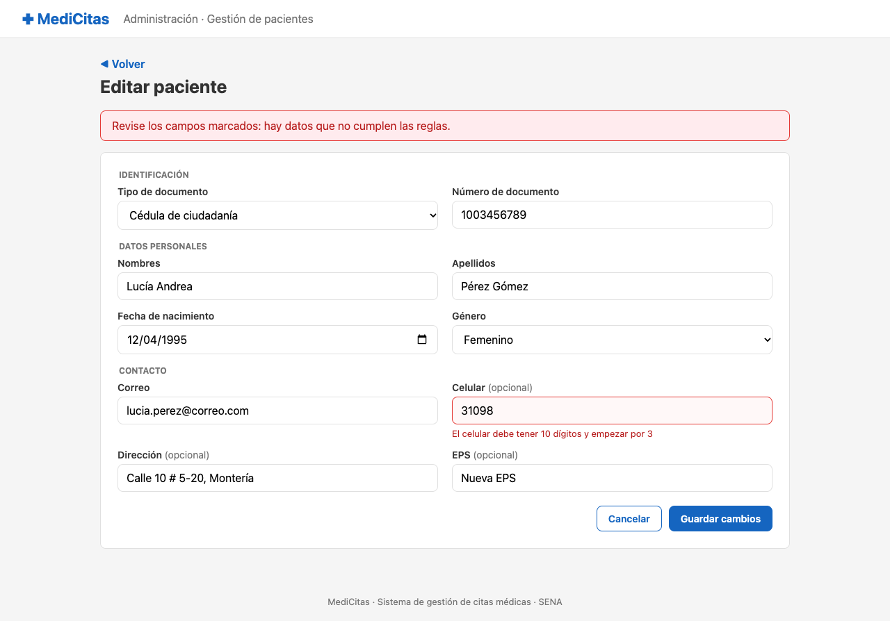

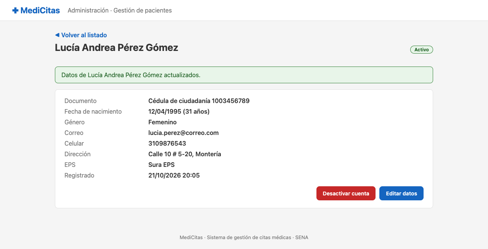

### HU-06 · Activar y desactivar cuenta

**Como** administrador, **quiero** desactivar o volver a activar la cuenta de un paciente, **para** impedir temporalmente su acceso sin perder su información ni su historial.

- Prioridad: Media · Ruta: `POST /pacientes/{id}/estado`

Criterios de aceptación:

1. El botón cambia entre «Desactivar cuenta» y «Activar cuenta» según el estado.
2. El cambio se confirma con un mensaje y se refleja en el detalle y en el listado.
3. No se borra ningún dato del paciente.

**Resultado:** Cumple. La cuenta pasa a Inactivo (también en el listado) y luego se vuelve a activar.

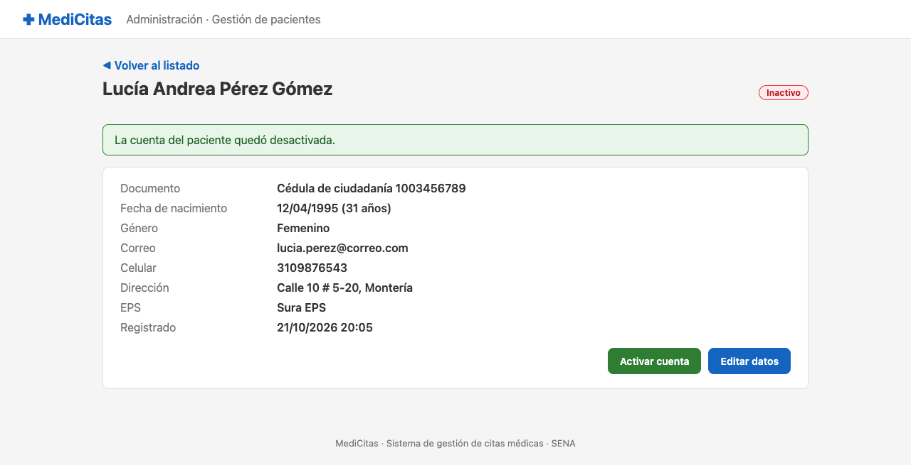

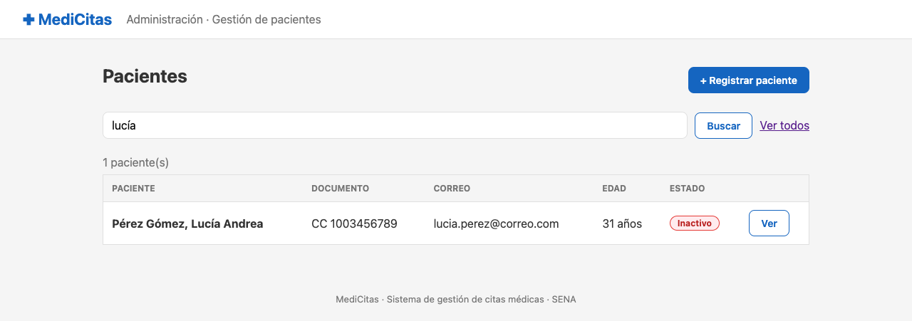

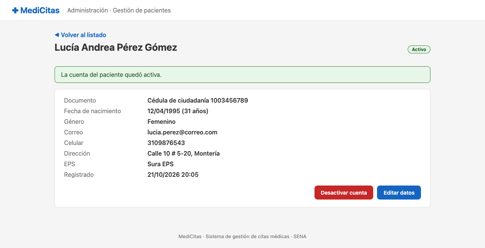

### HU-07 · Aviso de paciente inexistente

**Como** administrador, **quiero** recibir un aviso claro si abro un paciente que no existe, **para** no encontrarme con una página de error técnica.

- Prioridad: Baja · Ruta: `GET /pacientes/{id} con un id que no existe`

Criterios de aceptación:

1. El sistema redirige al listado.
2. Se muestra el mensaje «No existe un paciente con el id …».

**Resultado:** Cumple. Al abrir /pacientes/999999 se vuelve al listado con el aviso en rojo.

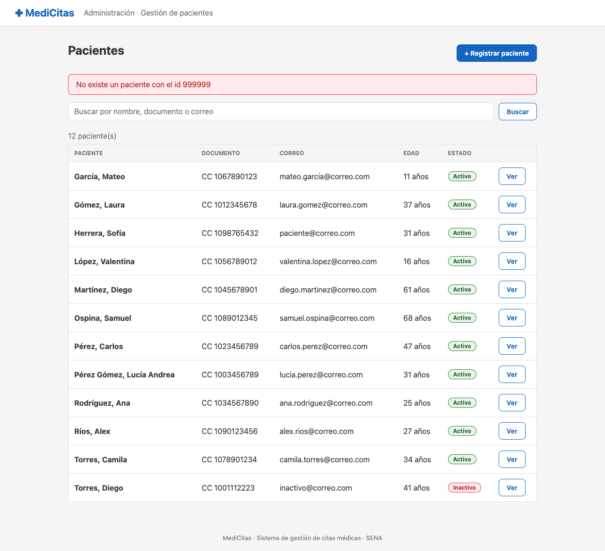

## Pruebas de validación

| ID | Tipo | Campo | Dato ingresado | Resultado | Mensaje |
|---|---|---|---|---|---|
| V-01 | Obligatorios | Todos | Formulario vacío | Rechazado ✓ | Un mensaje por campo: «Seleccione el tipo de documento», «El número de documento es obligatorio», «Los nombres son obligatorios», … |
| V-02 | Números | Documento | 12ab | Rechazado ✓ | El documento debe tener solo números, entre 6 y 10 dígitos |
| V-03 | Longitud | Documento | 12345678901 (11 dígitos) | Rechazado ✓ | El documento debe tener solo números, entre 6 y 10 dígitos |
| V-04 | Números | Documento | 1003456789 | Aceptado ✓ | — |
| V-05 | Textos | Nombres | Ana2 | Rechazado ✓ | Los nombres solo pueden tener letras y espacios |
| V-06 | Caracteres especiales | Apellidos | Pérez&lt;script> | Rechazado ✓ | Los apellidos solo pueden tener letras y espacios |
| V-07 | Longitud | Nombres | María de los Ángeles Guadalupe Concepción Esperanza Fernanda Isabel (67 caracteres) | Rechazado ✓ | Los nombres no pueden superar 60 caracteres |
| V-08 | Textos | Nombres | Lucía Andrea (tilde) | Aceptado ✓ | — |
| V-09 | Fechas | Fecha de nacimiento | 10/05/2030 (futura) | Rechazado ✓ | La fecha de nacimiento debe estar entre el 01/01/1900 y hoy |
| V-10 | Fechas | Fecha de nacimiento | 31/12/1899 | Rechazado ✓ | La fecha de nacimiento debe estar entre el 01/01/1900 y hoy |
| V-11 | Fechas | Fecha de nacimiento | 12/04/1995 | Aceptado ✓ | — |
| V-12 | Formato | Correo | lucia@correo | Rechazado ✓ | Escriba un correo válido, por ejemplo nombre@correo.com |
| V-13 | Números | Celular | 2001234567 | Rechazado ✓ | El celular debe tener 10 dígitos y empezar por 3 |
| V-14 | Longitud | Celular (edición) | 31098 | Rechazado ✓ | El celular debe tener 10 dígitos y empezar por 3 |
| V-15 | Caracteres especiales | Dirección | Calle 1; DROP TABLE users | Rechazado ✓ | La dirección no puede tener los caracteres &lt; > { } [ ] ; $ \ |
| V-16 | Caracteres especiales | Dirección | Calle 10 # 5-20, Montería | Aceptado ✓ | — |
| V-17 | Longitud | EPS | Entidad Promotora de Salud del Régimen Contributivo y Subsidiado de la Costa Norte (82 caracteres) | Rechazado ✓ | La EPS no puede superar 80 caracteres |
| V-18 | Duplicados | Documento | CC 1012345678 (ya registrado) | Rechazado ✓ | Ya existe un usuario con ese tipo y número de documento |
| V-19 | Duplicados | Correo | Laura.Gomez@correo.com (ya registrado, otras mayúsculas) | Rechazado ✓ | Ya existe un usuario con ese correo |

## Pruebas automáticas

`./mvnw test` → 44 pruebas, 0 fallas (PacienteFormularioTest 29, PacienteServicioTest 8, PacienteControladorTest 6, MedicitasPacientesApplicationTests 1).
